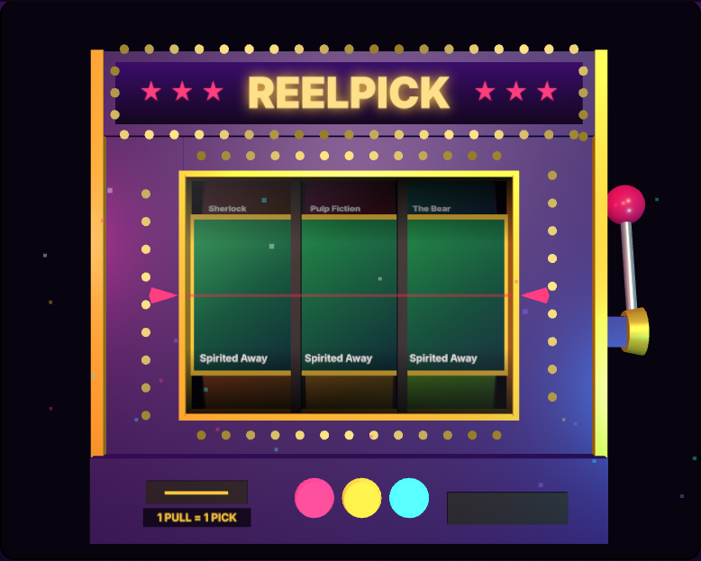
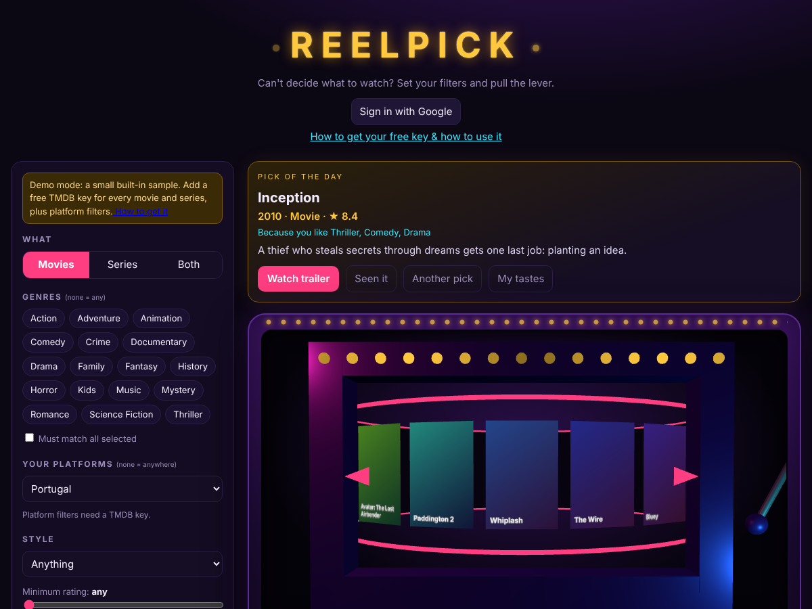
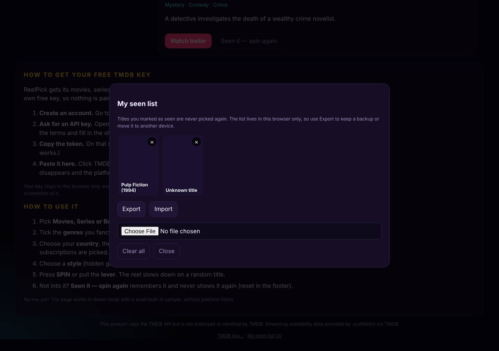
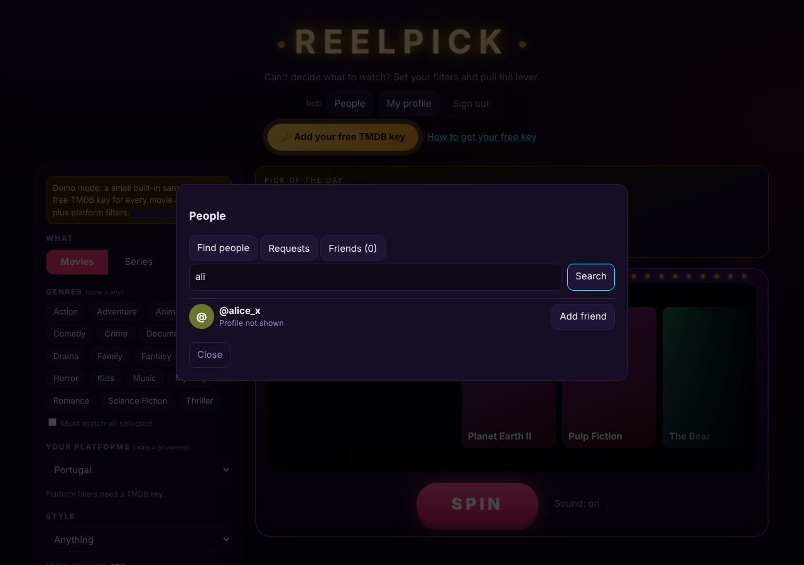
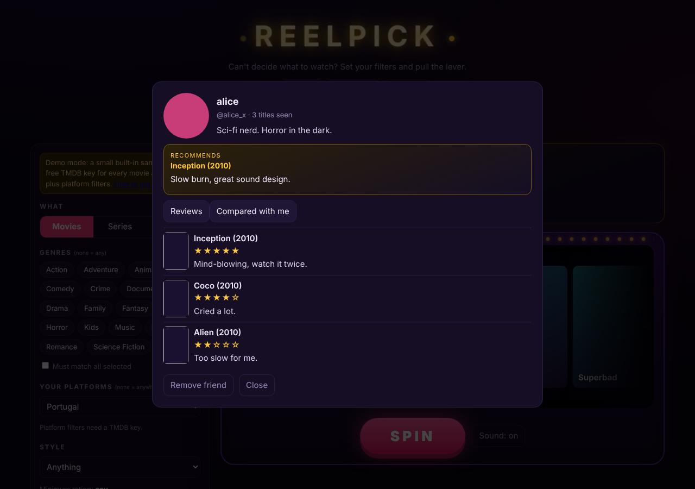
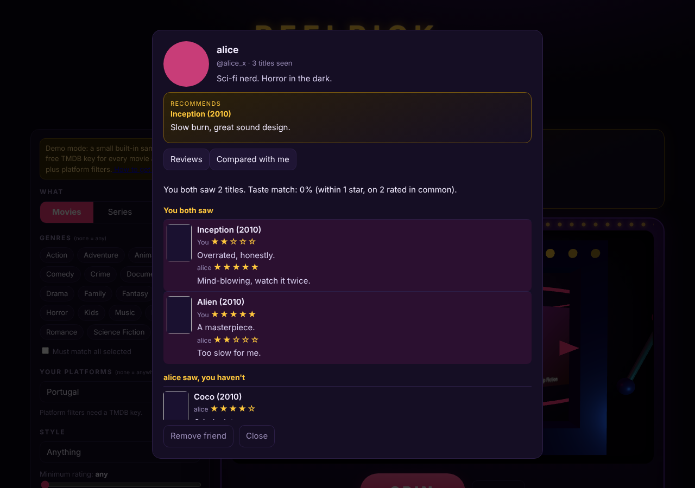

# ReelPick

A slot machine for movies and series. Choose type, genres, the streaming platforms you have and a style, pull the lever,
and the reel slows down on a random title that matches. Static page, no build step, free.

<table>
<tr>
<td width="34%"> Pull the lever</td>
<td width="34%"> Jackpot</td>
<td width="32%" rowspan="2" align="center"> On a phone</td>
</tr>
<tr>
<td> Pick of the day</td>
<td> My seen list</td>
</tr>
</table>

More screenshots: friends and profiles

 
<table>
<tr>
<td width="33%"> Find people</td>
<td width="33%"> A friend's profile</td>
<td width="33%"> Compare tastes</td>
</tr>
</table>

## Run

    python3 -m http.server 8810      # then open http://127.0.0.1:8810

It starts in **demo mode** (a small built-in sample). For every movie and series, add a free TMDB key:
create an account at themoviedb.org, Settings > API, and paste the *API Read Access Token* in "TMDB key…" (footer).
The key stays in your browser (localStorage) and is sent only to api.themoviedb.org.

## Filters
Movies / Series / Both, genres (any or all), your platforms for your country (flatrate only, via TMDB/JustWatch data),
styles (crowd pleasers, hidden gems, critically acclaimed, classics, recent, short), minimum rating.
"Seen it" titles go to a local "My seen list" (with posters, remove, export/import as JSON) and are never picked again.

## How a spin works
One discover request finds how many pages match, a random page is fetched, and one title is picked from it.
Titles with no poster are skipped. Pages beyond TMDB's 500-page limit are never reached.

## Tests
    node --test tests/*.test.mjs

## Credits
This product uses the TMDB API but is not endorsed or certified by TMDB. Streaming availability data provided by JustWatch via TMDB.

## Optional: accounts, friends and reviews (free)

Without setup, ReelPick works locally (your seen list lives in your browser). To enable Google sign-in, reviews, friends, profiles and the pick of the day synced across devices, use Firebase's free **Spark** plan (no card needed):

1. Create a project at <https://console.firebase.google.com>, add a **Web app** and copy its config.
2. *Authentication* › *Sign-in method* › enable **Google**. Under *Settings* › *Authorized domains* add your Pages domain (e.g. `joaoantunesss.github.io`).
3. *Firestore Database* › create a database, then paste the contents of `firestore.rules` in the *Rules* tab and publish.
4. Paste the config into `firebase-config.js` (it is not a secret; access is enforced by the rules).

Notes
- Profiles are **friends-only by default**; each person can choose private, friends or public. Only nickname-based discovery is public; friends are made through requests that the other person accepts.
- Profile photos are resized to 160×160 and stored inside the profile (Firebase Storage needs a paid plan, so it is not used).
- On first sign-in you choose your tastes; the **Pick of the day** is a daily suggestion (one per day, "Another pick" to reroll) based on them.
- Free-tier quotas are generous for personal use, but this was tested only with mocks: review `firestore.rules` before going public.
